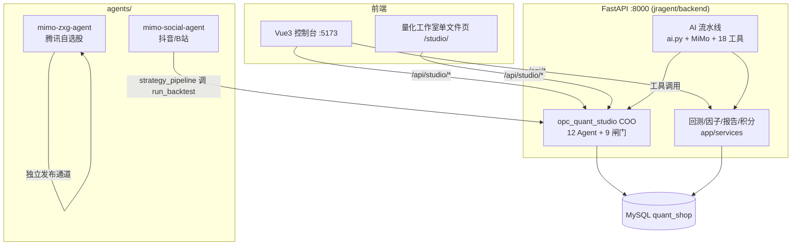
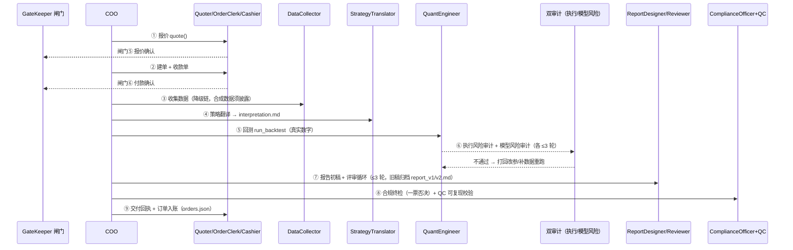
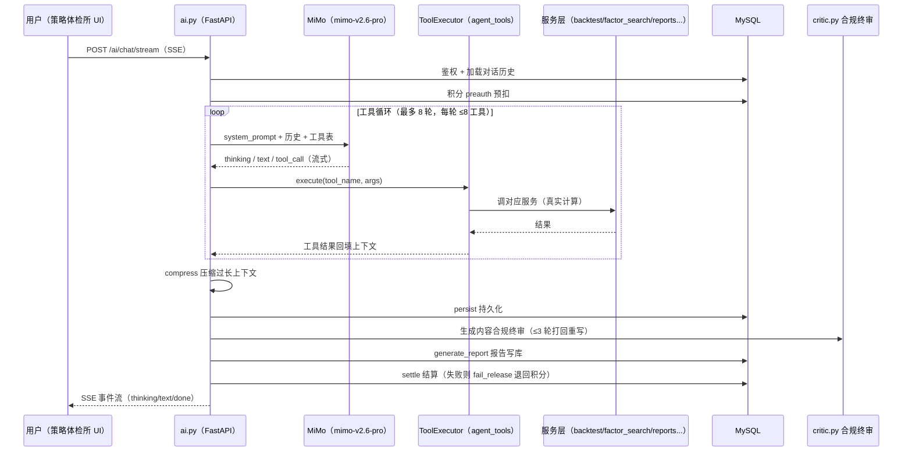

# jragent 项目 Agent 交互流程说明

> 本文档梳理本项目中各 Agent 体系的职责分工、调用关系与完整交互时序。
>
> 涉及目录：
>
> - `jragent/backend/` — FastAPI 主服务（策略体检所 + 量化研究工作室合并体）
> - `jragent/backend/opc_quant_studio/` — 确定性多 Agent 量化研究产线
> - `jragent/backend/app/` — 策略体检所业务（AI 对话、回测、因子、报告、积分）
> - `jragent/agents/mimo-social-agent/` — 抖音/B站社交回测 Agent
> - `jragent/agents/mimo-zxg-agent/` — 腾讯自选股内容发布 Agent
> - `jragent/frontend/` + `jragent/backend/static/studio/` — Vue3 控制台 + 量化工作室单文件页

---

## 0. 总览：四套 Agent 体系

| # | Agent 体系 | 代码位置 | 性质 | 对外入口 |
|---|---|---|---|---|
| 1 | opc_quant_studio 产线 | `backend/opc_quant_studio/` | COO 编排 + 12 专职 Agent + 9 人工闸门的确定性产线（LLM 可替换） | `/api/studio/*`（studio.py 9 端点） |
| 2 | 策略体检所 AI 流水线 | `backend/app/` | MiMo 大模型驱动、18 个工具的工具循环 Agent | `/ai/chat`、`/ai/chat/stream` |
| 3 | mimo-social-agent | `agents/mimo-social-agent/` | 抖音/B站刷视频、抓评论、回测、回帖的社交 Agent | `social-reply.md` skill + `bot.py` |
| 4 | mimo-zxg-agent | `agents/mimo-zxg-agent/` | 财经简报 → 事实核查 → 发布的双 skill 流水线 | `zxg-research.md` → `zxg-factcheck.md` + `bot.py` |

### 系统上下文图



---

## 1. opc_quant_studio 产线（COO + 12 Agent + 9 闸门）

### 1.1 角色清单

| 角色 | 类（agents.py） | 职责 |
|---|---|---|
| 总编排 | `COO`（orchestrator.py） | 串起全部 Agent、登记闸门、汇总交付 |
| 数据收集师 | `DataCollector` | 取行情，降级链：fetch_cn → fetch_baostock → fetch_public → synthetic（合成须披露） |
| 策略翻译官 | `StrategyTranslator` | 把策略翻成研究语言，产出 `interpretation.md`（逐条解读 + 参数表 + to_confirm） |
| 量化工程师 | `QuantEngineer` | 回测：逐 K 持仓、next-bar-open 成交、年化/回撤/夏普/胜率/换手/手续费 |
| 执行风险审计员 | `ExecutionRiskAuditor` | 审数据/成交假设/停牌/费用合理性，不达标打回重跑 |
| 模型风险审计员 | `ModelRiskAuditor` | 稳健性五板斧：样本外分段、参数敏感度、T+1 敏感度、走步检验、Deflated Sharpe |
| 报告设计 | `ReportDesigner` | 出报告初稿（收益/风险/交易/参数稳健性/适用边界/回撤解读/免责） |
| 评审 Agent | `Reviewer` | 六维评分 + top_issues，驱动评审循环 |
| 合规官 | `ComplianceOfficer` | 8 条红线约束检查，一票否决 |
| 报价官 | `Quoter` | fixed_tier 计价出报价单 |
| 订单员 | `OrderClerk` | 建单，产出 `receipt/order.md` |
| 收银员 | `Cashier` | 生成收款单 |
| GateKeeper | `gates.py` | 9 道人工闸门（auto 演示自动通过留痕 / manual 交互确认） |
| QC | orchestrator 内 | 校验 `strategy_spec.json` + `reproduce.py` 可复现资产 |

所有 Agent 通过 `ContextHub` 互相传递产物并在 `ContextHub.log` 留痕，只读写自己的上下文，由 COO 负责整体流转。

### 1.2 第一单闭环时序（run_first_order）



关键规则：

- **打回上限**：执行风险审计 ≤3 轮、模型风险审计 ≤3 轮、评审 Critique Loop ≤3 轮；3 轮仍不过直接终止（`AuditRejected`）。
- **合规一票否决**：命中 `license_forbidden / bonus_forbidden / anti_guarantee / three_red_lines / anti_misleading / data_boundary / investment_advice / anti_impersonation` 任一红线即不得交付。
- **可复现交付**：交付物含 `strategy_spec.json` + `reproduce.py`，QC 校验通过才发交付回执。
- **入账幂等**：`_book_order` 向 `orders.json` 幂等登记，防止重复入账。

### 1.3 九道人工闸门

| # | 闸门 | 触发点 |
|---|---|---|
| ① | 研究范围 | 下单前确认研究标的/问题 |
| ② | 资金上限 | 确认可投入资金上限 |
| ③ | 研究方案 | 方案确认 |
| ④ | 首轮交付 | 首份成果验收 |
| ⑤ | 报价确认 | 报价单生成后 |
| ⑥ | 付款确认 | 收款单生成后 |
| ⑦ | 多股票批量研究 | 多标的研究启动前 |
| ⑧ | 周报 | 周报产出后 |
| ⑨ | 真金白银下单 | 实盘下单前 |

`GateKeeper.checkpoint()`：auto 演示模式自动通过并在 `ContextHub.log` 留痕；manual 模式等待人工确认后放行。

### 1.4 分支流程

**多股票研究（`_run_multi_research`）**：闸门⑦ 放行 → 每只股票独立跑「收集→翻译→回测→报告」产出自包含单股报告 → 汇总层 `report_multi` 等权组合收益 → 组合级分析 → 生成组合报告（含"研究用、不构成投资建议"）→ 入账 → 交付回执。

**周报（`weekly_report`，阶段 6）**：汇总本周各产线产物 → 周报草稿 → 闸门⑧ → 确认后归档周报。

**studio API 与 COO 的交互**：`/api/studio/run` 触发 `run_first_order`；`/api/studio/state`、`/report`、`/chart`、`/log` 读产线状态与产物；`/checkout` + `/pay_confirm` 对应闸门⑤⑥；`/check_scope` 对应闸门①；`/weekly` 触发周报。COO 启动时幂等写入 `00-charter.md` 章程。

---

## 2. 策略体检所 AI 流水线（MiMo + 18 工具）

### 2.1 AI 对话工具循环完整时序



### 2.2 18 个工具分组（agent_tools.py）

| 分组 | 工具 | 说明 |
|---|---|---|
| 回测/研究 | run_backtest、strategy_recommend、robustness_check、walk_forward_test、deflated_sharpe | 两条铁律：AI 只输出策略框架+参数、**不写可执行代码**；推荐前**必须** run_backtest 拿真实数字 |
| 因子 | factor_library、factor_planner、factor_search、factor_detail、compare_factors、add_factor_to_combo、get_factor_stats | 因子检索、规划、搜索、对比、入组合 |
| 组合 | build_portfolio、rebalance_portfolio | 组合构建与再平衡 |
| 报告 | generate_report、save_report、get_report_history、preview_chart | 报告生成/存取/预览 |
| 系统 | get_indicators、get_stock_history、sentiment | 指标口径、行情、舆情 |

### 2.3 因子搜索协作链

```
factor_planner（16 因子画像按用户目标选 3-5 候选）
    → factor_search（分位阈值贪心叠加 ≤3 条件 + 样本外验证 + 过拟合评级）
        → factor_engine / custom_factor（AST 沙箱自定义因子）/ extended_factors / factor_demo
            → critic 合规终审 → robustness_check → report_builder 产出数字真实的报告
```

### 2.4 服务层职责一览（app/services/）

| 模块 | 职责 |
|---|---|
| mimo.py | MiMo API 封装，thinking/text/done 流式，reasoning_content 回填 |
| agent_tools.py | 18 工具定义 + ToolExecutor + SYSTEM_PROMPT |
| context.py | MySQLToolContext，工具调用留痕 |
| lab.py | 回测引擎 + PARAM_SPEC 9 种策略参数规格 |
| backtest.py / backtest_service.py | 回测编排与缓存 |
| factor_planner.py / factor_search.py / factor_engine.py / custom_factor.py / extended_factors.py / factor_analysis.py | 因子链 |
| critic.py | 合规终审（Rule/Medium/Low 分级打回 ≤3 轮） |
| report_builder.py / report_analytics.py / reports.py | 报告生成与分析（数字必须真实，禁编造） |
| robustness.py / param_sensitivity.py | 稳健性与参数敏感度 |
| portfolio.py | 组合构建/再平衡 |
| stock_service.py / indicators.py / calendar_utils.py | 行情、指标口径、交易日历 |
| credits.py / credit_service.py / refund.py | 积分预扣/结算/退回 |
| conversation_service.py | 对话持久化 |

---

## 3. mimo-social-agent（抖音/B站社交回测 Agent）

### 3.1 social-reply.md skill 流程

```
browse（bot.py browse --platform 抖音/B站，刷视频抓评论）
    → scan（关键词初筛：策略类 / 有价值 / 可回复）
        → 生成回复（口吻自然、禁投资建议、数字有据）
            → reply（bot.py reply，安全闸门后发帖）
```

安全闸门（bot.py）：评论去重、每日回复上限、违禁词过滤、单次提交不重试（避免重复发帖）。`state.json` 记录已回视频与当日计数。

### 3.2 strategy_pipeline.py 策略回测流水线（与 opc_quant_studio 联动）

```
① 刷视频抓评论（bot.py browse）
    → ② 策略关键词识别（均线/金叉/MACD/KDJ/突破 等正则 KEY_PATTERNS）
        → ③ 调 opc_quant_studio 真回测
           （sys.path 注入 backend，StrategyTranslator.translate + run_backtest）
            → ④ 模板化回复（回测数字 + 合规提示："研究用、不构成投资建议"）
                → ⑤ bot.py reply 回帖（--apply 实际发布，否则 dry-run）
```

---

## 4. mimo-zxg-agent（腾讯自选股发布 Agent）

### 4.1 双 skill 顺序流水线

```
zxg-research.md（Agent 访问财经网站）
    → 筛选"对股市有影响 + 对读者有用"的初筛要素
        → 产出 reports/YYYY-MM-DD-brief.md 财经简报
            → zxg-factcheck.md（逐条事实核查，剔除无法证实的说法）
                → 产出 *-verified.md 核查稿 + *-publish.txt 发布终稿
                    → bot.py zxg-publish（Playwright 发帖到腾讯自选股）
```

`webui.py` 提供本地控制台（127.0.0.1:8766）供人工调度与复核。

### 4.2 发布安全闸门（bot.py）

- 登录态检测（p_uin/skey Cookie + 页面证据），`zxg-login` / `zxg-auth-status` / `zxg-logout` 管理会话
- 发布内容 MD5 去重、每日限额、违禁词过滤
- 单次提交不重试（失败即停，避免重复发帖）

---

## 5. 跨模块协作与入口汇总

### 5.1 协作矩阵

| 上游 | 下游 | 交互内容 |
|---|---|---|
| Vue3 控制台 / studio 页 | FastAPI | `/api/*`（体检所）、`/api/studio/*`（工作室） |
| AI 流水线（ai.py） | agent_tools 18 工具 → 各服务 | 工具循环拿真实数字 |
| AI 流水线 | critic.py | 生成内容合规终审 |
| studio API | opc_quant_studio COO | 驱动报价→闸门→研究→交付全流程 |
| mimo-social-agent strategy_pipeline | opc_quant_studio | `run_backtest` 真回测后回帖 |
| mimo-zxg-agent | 自身双 skill + bot.py | 独立发布通道，不经过后端 |

### 5.2 端口与入口

| 入口 | 地址 | 说明 |
|---|---|---|
| 策略体检所 + 工作室 | http://localhost:5173 | Vue3 控制台（代理 `/api` → 8000） |
| 量化工作室单文件页 | http://localhost:8000/studio/ | 独立部署版（可由控制台进入） |
| 后端 API | http://localhost:8000 | FastAPI |
| 自选股发布控制台 | http://127.0.0.1:8766 | mimo-zxg-agent webui.py（本地） |

### 5.3 全链路一致性约束

1. **AI 不写可执行代码**：策略只输出框架 + 参数，执行统一走确定性引擎（lab.py / opc_quant_studio）。
2. **数字必须真实**：任何推荐/报告中的收益、回撤等数字均来自真实回测，禁止编造。
3. **合规底线**：研究用、不构成投资建议；收益不承诺；持牌边界；8 条红线一票否决。
4. **留痕可审计**：ContextHub.log、state.json、orders.json、对话持久化、工具调用留痕（MySQLToolContext）。
5. **幂等防重**：订单入账幂等、发布单次提交不重试、内容 MD5 去重。
