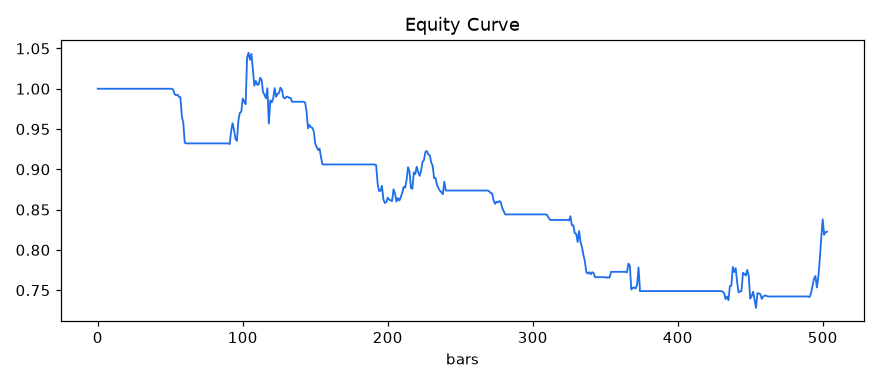
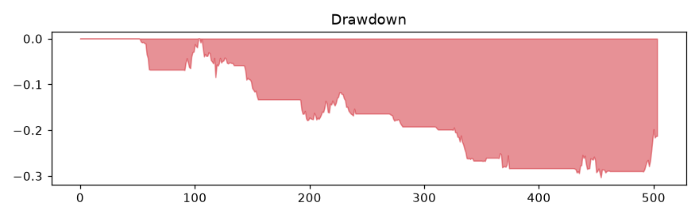
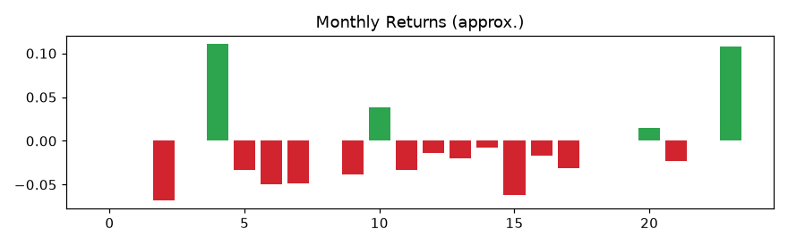

# 策略研究报告 · 策略研究-对股票进行均值回归

## 摘要

本报告针对策略「策略研究-对股票进行均值回归」（原始想法：对股票进行均值回归）进行量化建模与历史回测研究。回测区间共 504 个交易日，数据快照 SNAP-94dc249f，手续费与滑点假设 0.10%/边。本报告为研究服务交付物，不构成投资建议。

## 策略解读与微调指引

用户给出的策略为自然语言描述，部分逻辑并不清晰。本章把「您写的 → 我们理解的」逐条对照列出，并标注每项参数是**用户明确指定**还是**默认假设**，供您核对与微调。

> **您的原始描述**：对股票进行均值回归

**理解概况**：共 5 项要点中 0 项由您的描述明确、5 项为默认假设（下方逐项列出，可对照微调）

### 逐条解读对照

| 原文线索 | 翻译结果 | 确定性 | 说明 |
|---|---|---|---|
| 规则类型相关表述 | 均线交叉（金叉买入/死叉卖出） | 默认假设（原文未说明规则类型） | 决定开仓/平仓的触发方式 |
| （未提及周期） | 快线 10 日 / 慢线 40 日 | 默认假设（原文未给出周期） | 决定开平仓信号的计算窗口 |
| （未提及止损） | 持仓浮亏达 5% 即强制离场 | 默认假设（原文未给出止损） | 控制单笔最大亏损的兜底规则 |
| （未提及仓位） | 满仓（100%）一次性进出 | 默认假设 | 原文未描述资金管理/加减仓 |
| （未提及做空/杠杆） | 只做多，离场即空仓等待 | 默认假设 | 原文未描述做空、杠杆与再入场规则 |

### 参数微调指引

下表列出本次回测实际使用的全部参数。若您发现任何一项与本意不符，按「如何微调」列修改想法描述后重新下单即可，无需改动代码：

| 参数 | 当前取值 | 来源 | 如何微调 |
|---|---|---|---|
| 规则类型 | 均线交叉 | 默认假设（原文未说明规则类型） | 在想法中写明「突破」或「均线交叉/金叉」 |
| 快线周期 | 10 | 默认假设（原文未给出周期） | 在想法中以「快线/慢线」形式给出，如 5/20 |
| 慢线周期 | 40 | 默认假设（原文未给出周期） | 同上，与快线周期一起给出 |
| 止损 | 5% | 默认假设（原文未给出止损） | 在想法中写「止损 X%」 |
| 仓位 | 100%（满仓进出） | 默认假设（原文未提仓位） | 如需分批/半仓请说明仓位规则（当前引擎仅支持固定仓位） |

### 执行假设（未在描述中给出，回测按以下口径执行）

- 仓位：默认满仓（100%）一次性进出，未做加减仓与资金管理。
- 交易成本：手续费与滑点合计 0.10%/边（引擎统一口径）。
- 执行滞后：t 日收盘信号 t+1 日成交（≥1 根K线，杜绝未来函数）。
- 只做多：触发离场信号即空仓等待，不做空、不加杠杆。
- 数据口径：标的近 1-2 年公开日线（来源见「回测假设」章）。

### 待确认的不确定处

- ❓ 规则类型未明确，暂按「均线交叉」理解；若您想做突破跟踪或其他规则，请在微调时说明。
- ❓ 均线/窗口周期未给出，暂用 10/40（快线/慢线），可按需微调。
- ❓ 止损比例未给出，暂用 5%，可按风险承受度微调。

## 策略规格

- 规则类型：ma_cross
- 入场：MA10 上穿 MA40 金叉看多
- 出场：MA10 下穿 MA40 死叉离场（或止损 5%）
- 快线/慢线：10/40
- 止损：5%
- 仓位：100%
- 执行滞后：1 根K线（t 日信号 t+1 日成交）

## 回测假设

数据口径：baostock:sh.600519（真实公开数据·独立服务器·国内直连）（快照见 09-backtest/）；手续费与滑点合计 0.10%/边；未考虑涨跌停与流动性冲击；年化按 252 交易日。

## 回测结果

| 指标 | 数值 |
|---|---|
| 累计收益 | -17.74% |
| 年化收益 | -9.32% |
| 最大回撤 | -30.31% |
| 夏普比率 | -0.68 |
| 胜率 | 20.0% |
| 交易次数 | 15 |
| 年化换手 | 15.5 |

## 风险揭示

本策略历史最大回撤为 -30.31%；样本外（后 30%）夏普为 1.25（样本内 -1.57）；参数扰动夏普极差 0.68。历史回测不代表未来表现，极端行情下回撤可能显著扩大。

## 风控审计

**检查总表**

- ✅ 未来函数：执行滞后=1（t 日信号 t+1 日成交）
- ✅ 过拟合（样本内外）：样本内夏普=-1.566，样本外夏普=1.253
- ❌ 参数敏感性：网格扰动夏普极差=0.68（9 组）
- ✅ 幸存者偏差：股票池口径：单一标的全样本日线（前复权），无成分剔入剔出，无幸存者偏差

审计结论：**有条件通过**

### 执行风险审计员完整审计结论（未来函数 / 参数敏感性）

**审计范围**：未来函数（数据泄漏）与参数敏感性。

**审计对象**：策略「策略研究-对股票进行均值回归」（ma_cross 10/40）× 数据快照 SNAP-94dc249f。

#### 1. 未来函数（数据泄漏）

- **判定标准**：成交至少滞后信号 1 根K线——t 日收盘后得到的信号最早 t+1 日成交，指标计算只使用截至当日已知的数据。
- **实测**：回测引擎执行滞后 = 1 根K线（事件循环中 `sig[i-1]` 于第 i 日成交），信号与成交严格错开。
- **判定**：✅ 通过。
- **风险含义**：若按当日收盘价成交当日信号，等于让资金「预知」当日走势，回测收益被系统性虚增且实盘不可复制。本项是审计红线：不通过即否决。

#### 2. 参数敏感性

- **判定标准**：在快线 10±3、慢线 40±5 的网格上逐一重跑回测，夏普极差 ≤ 1.5，且正夏普参数组合占比 ≥ 60%。
- **实测**（9 组有效参数）：最优 快线 13/慢线 45 夏普 -0.286；最差 快线 13/慢线 35 夏普 -0.968；夏普极差 **0.68**；正夏普 0/9（0%）。
- **逐组结果**：
  - 快线 7 / 慢线 35 → 夏普 -0.943
  - 快线 7 / 慢线 40 → 夏普 -0.834
  - 快线 7 / 慢线 45 → 夏普 -0.81
  - 快线 10 / 慢线 35 → 夏普 -0.903
  - 快线 10 / 慢线 40 → 夏普 -0.684
  - 快线 10 / 慢线 45 → 夏普 -0.351
  - 快线 13 / 慢线 35 → 夏普 -0.968
  - 快线 13 / 慢线 40 → 夏普 -0.639
  - 快线 13 / 慢线 45 → 夏普 -0.286
- **判定**：❌ 不通过（极差 ≤ 1.5 且正夏普占比 ≥ 60%）。
- **风险含义**：极差过大说明收益集中在单一参数点（「参数悬崖」），参数轻微漂移策略即失效，也提示参数是为历史数据量身挑选的（数据挖掘偏差），真实前向表现大概率衰减。
- **微调建议**：优先在上表表现稳定的参数邻域内微调，不要追逐网格内的单点最优；若极差过大，可简化规则、拉长回测样本或改用更稳健的参数区间后重新审计。

**综合判断（有条件通过）**：
- 参数敏感性不通过：收益过度依赖个别参数点，建议在稳定参数邻域微调，或简化规则/扩大样本后重新审计。

### 模型风险审计员完整审计结论（过拟合 / 幸存者偏差）

**审计范围**：过拟合（样本内外对比）与幸存者偏差。

**审计对象**：策略「策略研究-对股票进行均值回归」（ma_cross 10/40）× 数据快照 SNAP-94dc249f。

#### 1. 过拟合（样本内外对比）

- **判定标准**：按时间切分样本内（前 70%，352 个交易日）与样本外（后 30%，152 个交易日），同一参数分别回测；样本外夏普 ≥ 样本内夏普的 30%，且样本外总收益 > -15%。
- **实测**：样本内夏普 **-1.566**，样本外夏普 **1.253**（样本外/样本内 = -80%）；样本外总收益 9.84%。
- **判定**：✅ 通过。
- **风险含义**：样本外表现大幅衰减（甚至转亏）说明规则更可能拟合了历史噪声而非可重复的市场规律，实盘沿用该参数的期望收益应显著低于回测值。
- **微调建议**：简化规则与参数数量、扩大回测样本、做滚动样本外验证（Walk-Forward），并以样本外表现而非全样本表现为准选择参数。

#### 2. 幸存者偏差

- **判定标准**：数据快照必须记录股票池口径（选样范围与纳入/剔除规则），标的的回测对象可追溯到选样规则。
- **实测**：股票池口径 = 单一标的全样本日线（前复权），无成分剔入剔出，无幸存者偏差。
- **判定**：✅ 通过。
- **风险含义**：若股票池只保留存活至今的标的（退市、暴雷、长期停牌股被剔除），历史收益会被系统性高估，回测结果无法代表当时的可选范围。
- **微调建议**：使用含退市标的的全历史成分数据，或明确记录指数/股票池的历史成分口径后重新审计。

**综合判断（通过）**：
- 两项检查均通过：样本外表现与样本内可比，且选样口径可追溯，未见明显过拟合与幸存者偏差。

## 可复现说明

数据快照 ID：SNAP-94dc249f；策略参数 JSON 与回测代码存于 `09-backtest/ORD-024/`，凭快照 + 代码可完整复现本报告全部指标。

## 免责声明与风险揭示

- 本报告不构成投资建议。
- 历史回测不代表未来表现。

## 附图

